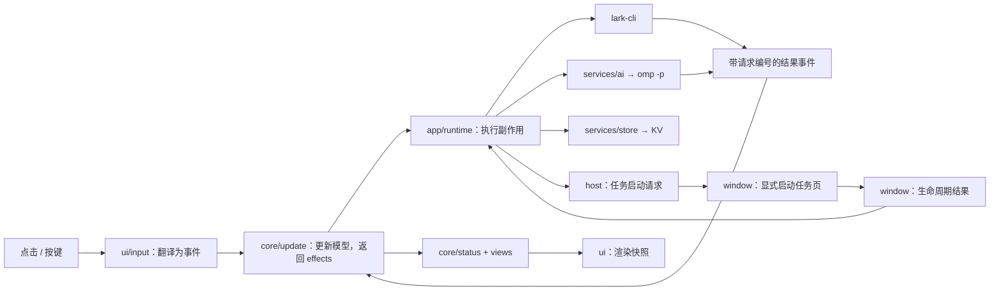

# 插件架构

## 双仓库提示词边界

- 插件拥有阶段约束、模型输入输出、材料与讨论判定、证据包装、确认与结果回收协议。`prompts/*.md` 与消费代码一起变更，不从业务 Workspace 复制协议。
- `feishu-workflow` 等 Workspace 只拥有业务技能、身份限制、审批条件、可信目录、处理偏好与记忆；必要业务约束随已确认任务交接，插件不假设某位用户的账号权限或具体 CR 流程。
- 初判和工作台对话加载业务 Workspace 的策略。视觉评估与文本缺口判定使用插件数据目录下各自的隔离 cwd、窄配置和专用 system，不加载业务项目上下文、规则、技能、扩展和记忆；保留全局角色、模型与认证配置。视觉无工具，文本判定只开放 JS eval 和 judge 文档读取。显式 guard 同时约束 MCP/动态工具；这是模型工具边界，不是操作系统进程沙箱。
- 执行会话只接收通用交接头、用户确认的任务和所需第三方证据，并加载目标 Workspace 自己的指令。阶段标识由代码添加：`<!-- feishu-workbench:v1 stage=... -->`，不依赖中文标题识别新会话。
- 初判、增量分析和工作台对话都携带 `self.open_id`，来源为既有 `lark.whoami` 刷新得到的 `model.me`，不增加身份查询或联系人权限；续接会话也更新该字段。缺失时明确为 null，不从聊天文字猜姓名或账号。模型按该 ID 区分本人和其他人的待办，此字段不构成操作授权，也不改变 user/bot 的执行身份。

## 运行架构

保留 Tern 的 host/window 双运行环境，不引入常驻服务、额外凭证库或新的模型 SDK。



- **host** 持有工作台模型、分析调度、历史分页和持久化写入者。多个工作台面板共享该模型，避免独立快照互相覆盖。
- **window** 只注册命令、启动任务页、处理任务生命周期；不改工作台队列。
- **运行时** 将同步缓存命中和异步回调都排成事件队列，避免状态更新重入。所有回调经过运行时存活检查。
- **核心** 独占模型写入权；就地更新自己持有的模型，返回副作用描述，不复制整条队列、不调用外部服务。时间来自 `cfg.now`。
- **调度** 从分析的运行阶段计算占用名额；统一登记/取消计时器。任务状态只在有关联任务时轮询；聊天稳定时间、定时刷新各自独立。

## 代码架构

```text
host.luau / window.luau       薄入口
prompts/*.md                 系统约束、初判、对话、关联判断、任务交接模板
src/
  core/
    types                    Matter / Model 类型
    matter                   构造、规则、连续消息合并
    status / views           唯一的状态、动作、视图、计数与标签名推导
    update                   事件转换、调度和副作用描述
    judgment                 模型输出的结构化校验
    history                  只读历史分页
    snapshot                 v1/v2→v3 迁移、验证、序列化
    task / events            结构化任务生命周期、目录规则、不可变事件与请求关联
  services/
    lark / omp / ai          外部调用和模型用途接口
    launch / stage           业务/隔离阶段启动、目录校验与真实 argv
    prompts / stage_guard    模板装配与专用阶段的工具注册表约束
    store / events           快照持久化与单一 host 事件写入者
  shared/
    schema / settings        纯设置定义与边界存取
    bridge                   host/window 的任务协议与迁移
    keymap / text / time     快捷键、UTF-16 编辑与时间显示
    markup / template        消息标记和模板纯函数
  app/
    host / window            Tern 注册、命令和生命周期事件
    runtime                  副作用执行器
    fetch                    消息来源、游标、日程与群设置刷新
  ui/                        布局、队列、详情、对话、设置、历史和输入映射
styles/                      Tern 主题样式
scripts/check.sh / tests/    编译、纯模块严格类型检查和行为回归
```

`core` 及纯 `shared` 模块不依赖 Tern。渲染通过 `ui/primitives` 使用 Tern UI；不读 KV、设置服务或外部 API。边界读到的未知数据在模型结果解析、快照解析和服务协议处校验。

## 状态约定

一个事项分开记录：

- `analysis`：阶段、请求编号、判断、会话、分析进度与错误。
- `disposition`：待处理、稍后、待发送、任务中、已归档或已回复。
- `task`：任务页阶段、结果和任务启动后的新消息数。
- `edits`：用户修改的回复稿和任务说明，不与模型原稿混存。

显示状态、下一步动作及视图成员均通过选择器计算。标签和顶部计数使用同一入口。任务 idle 只是本轮结束；可能的飞书回复仍需用户确认。历史检索不创建事项、不调用分析、不改变处理状态。

每个异步操作带请求编号。线程结果还匹配触发消息；任务准备和对话结果还检查事项修订号。新消息、编辑、归档等不能被旧请求覆盖。

## 跨端任务协议

| 数据 | 写入者 | 内容 |
|---|---|---|
| `task-request:<id>` | host | v2：事项、修订号、请求号、任务正文、结构化 workspace、冻结默认目录、完整提示词与标题 |
| `task-sequence` | host | 持久化的递增请求编号 |
| `task-state:<id>` | window | 对应请求编号、窗格、阶段、本轮结果 |
| `task-pane:<pane>` | window | 窗格到事项和请求编号的映射 |

同一请求号才能合并读取，请求与结果不回写为一个共享记录。窗口在启动前记录认领；重复链接只聚焦已有页，不能重放已认领请求。中断启动需要显式重试，重试生成新请求号。旧窗格回调不能更新新任务。

执行目录只来自确认请求的结构化 `workspace` 字段，空字符串使用确认时冻结的默认目录；目标仍须在该默认目录 `workspaces.md` 第二列并可读。任务 Markdown、第三方消息和新一轮设置不能改变已确认目录。旧快照中的首行目录仅在一次性迁移时拆为独立字段；无法安全迁移的旧任务请求要求重新确认，已运行任务不重放。

## 持久化与模型

- 快照格式 v3；保存有意义的业务状态，不存回调、计时器、blob 或请求句柄。
- 普通更新合并 500ms 内写入；开始分析、对话和任务前立即写入。退役模型的计时器不能覆盖当前写入者。
- 重载将运行中的分析标为中断，不自动重放；损坏/未知快照明确报错，不静默清空。
- 单独的 `decisions` 只是缓存外消息再次检索时的处理结果索引；活跃事项的去向由模型唯一持有。
- 初判、对话和文本判断调度按用途分别选主模型，留空继承用户配置。纯文本通过 eval 的 `judge()` 调用 judge 角色；选中图片直接使用 `@vision` 对话角色。不绑定 TypeSafe/jev 或视觉型号，不读取凭证，也不把 `@judge` 当作对话模型。

## 上下文需求判断

`prompts/context.md` 定义两个独立需求：`materials` 与 `discussion`，各自取 `required / not_required / unknown`。定位符不等于材料内容。`core/context` 将两个需求组合成执行范围；任一仍未知则阻止启动。任务已有的来源定位由代码去重，不影响材料是否必需。

无选中图片时使用配置中的 judge 角色，读取实际工具结果。选中图片时，`services/vision.assess` 复用已有下载文件（缺失才下载），直接由 `@vision` 一次返回材料和讨论需求，不再先后调用 judge。

`core/image_sources` 只负责选择消息中的图片 key；`core/context` 组合两项需求并做定位去重。图片每次最多 3 张，读不到或需求不确定时提示补充。没有视觉事实缓存、哈希校验、冻结图片或初判证据回收；不新增持久化格式。

概率不是校准准确率，不凭少量样本设置信心阈值。未知、无效输出、必需图片未能取得证据时不启动任务；不回退纯文本猜图。手动开任务不调用 judge 或 vision，仍等待用户指示。两条模型路径均有实际调用成本，文本路径还含主模型调度开销。

## 结构化记忆事件

单一 host 在插件数据目录的 `workbench-events/<序号>.json` 写不可变 v1 记录：`id/type/at/workspace/matter_id/revision`，以及可选的 `request_id/session` 和类型化 `data`。`workspace` 是运行时冻结的业务默认目录，任务实际目录在 `data.execution_workspace`；不包含原始飞书消息或图片。

事件类型为 `analysis`、`workbench_chat`、`task_confirmed`、`task_result`。确认事件必须先持久化再发布启动请求；结果只关联同一请求，旧回调或重复轮询不能产生重复结果。任务轮次结束不是业务成功。事件写入失败显式报错，不静默继续交办；顶部提示在下一次写入成功后消失，且和 omp 目录回退警告一样不写入快照，重载后不会残留。存储读回的 JSON 数组带只读元表，收据更新逐项复制而不用 `table.clone`。

workflow 的采集器按记录版本、目录、请求和时间范围消费这些事件，不匹配中文任务头、不扫描目标代码仓库。目标 Workspace 的关联任务结论因此可回流；工作台 `/` 纠正完整记录。任务页后续直接用户发言目前仍只通过默认 Workspace 的本地历史采集；Tern transcript 没有稳定消息 ID、时间和截断标记，不宣称已可靠回流目标仓库中的全部后续纠正。

## 验证

`scripts/check.sh` 编译生产模块和测试，严格检查纯模块，再运行 Luau 行为用例和 Node 阶段 guard 用例。覆盖状态机、目录字段与旧数据迁移、过期请求、图片证据、事件持久化与结果去重、阶段上下文及工具隔离。另以真实 omp 的视觉/文本 judge 调用、插件事件到 workflow 采集器的合成交接，以及隔离 Tern 界面验证实际路径；烟测不执行业务写入。

合成任务页、分析或事件烟测必须使用独立的 `TERN_CONFIG_DIR`（插件数据）和临时默认 Workspace，不能在真实业务 Workspace 启动。业务 Workspace 的记忆整理会采集该目录的本地会话与插件事件；合成数据一旦写入真实目录，会被当成用户记录参与整理。
