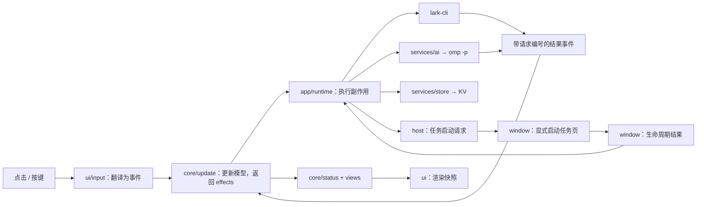

# 插件架构

## 运行架构

保留 Tern 的 host/window 双运行环境，不引入常驻服务、额外凭证库或新的模型 SDK。



- **host** 持有工作台模型、分析调度、历史分页和持久化写入者。多个工作台面板共享该模型，避免独立快照互相覆盖。
- **window** 只注册命令、启动任务页、处理任务生命周期；不改工作台队列。
- **运行时** 将同步缓存命中和异步回调都排成事件队列，避免状态更新重入。所有回调经过运行时存活检查。
- **核心** 独占模型写入权；就地更新自己持有的模型，返回副作用描述，不复制整条队列、不调用外部服务。时间来自 `cfg.now`。
- **调度** 从分析的运行阶段计算占用名额；统一登记/取消计时器。任务状态只在有关联任务时轮询；聊天稳定时间、定时刷新各自独立。

## 代码架构

```text
host.luau / window.luau       薄入口
prompts/*.md                 系统约束、初判、对话、关联判断、任务交接模板
src/
  core/
    types                    Matter / Model 类型
    matter                   构造、规则、连续消息合并
    status / views           唯一的状态、动作、视图、计数与标签名推导
    update                   事件转换、调度和副作用描述
    judgment                 模型输出的结构化校验
    history                  只读历史分页
    snapshot                 v1→v2 迁移、验证、序列化
    task                     任务页生命周期、请求结果匹配、目录规则
  services/
    lark / omp / ai          外部调用和模型用途接口
    launch                   程序、PATH、工作目录与可信目录检查
    prompts                  文件加载与模板填充
    store                    KV 读写、延迟保存及写入所有权
  shared/
    schema / settings        纯设置定义与边界存取
    bridge                   host/window 的任务协议与迁移
    keymap / text / time     快捷键、UTF-16 编辑与时间显示
    markup / template        消息标记和模板纯函数
  app/
    host / window            Tern 注册、命令和生命周期事件
    runtime                  副作用执行器
    fetch                    消息来源、游标、日程与群设置刷新
  ui/                        布局、队列、详情、对话、设置、历史和输入映射
styles/                      Tern 主题样式
scripts/check.sh / tests/    编译、纯模块严格类型检查和行为回归
```

`core` 及纯 `shared` 模块不依赖 Tern。渲染通过 `ui/primitives` 使用 Tern UI；不读 KV、设置服务或外部 API。边界读到的未知数据在模型结果解析、快照解析和服务协议处校验。

## 状态约定

一个事项分开记录：

- `analysis`：阶段、请求编号、判断、会话、分析进度与错误。
- `disposition`：待处理、稍后、待发送、任务中、已归档或已回复。
- `task`：任务页阶段、结果和任务启动后的新消息数。
- `edits`：用户修改的回复稿和任务说明，不与模型原稿混存。

显示状态、下一步动作及视图成员均通过选择器计算。标签和顶部计数使用同一入口。任务 idle 只是本轮结束；可能的飞书回复仍需用户确认。历史检索不创建事项、不调用分析、不改变处理状态。

每个异步操作带请求编号。线程结果还匹配触发消息；任务准备和对话结果还检查事项修订号。新消息、编辑、归档等不能被旧请求覆盖。

## 跨端任务协议

| 数据 | 写入者 | 内容 |
|---|---|---|
| `task-request:<id>` | host | 请求编号、确认任务原文、完整提示词、标题 |
| `task-sequence` | host | 持久化的递增请求编号 |
| `task-state:<id>` | window | 对应请求编号、窗格、阶段、本轮结果 |
| `task-pane:<pane>` | window | 窗格到事项和请求编号的映射 |

同一请求号才能合并读取，请求与结果不回写为一个共享记录。窗口在启动前记录认领；重复链接只聚焦已有页，不能重放已认领请求。中断启动需要显式重试，重试生成新请求号。旧窗格回调不能更新新任务。

`task:<id>` 与 `task_panes` 仅在一次性迁移中读取并删除。执行目录来自请求内的确认任务原文，只有首行 `执行 Workspace：…` 生效；第三方消息和渲染后的提示词不参与选择。目标还须在可信 `workspaces.md` 第二列并可读。

## 持久化与模型

- 快照格式 v2；保存有意义的业务状态，不存回调、计时器、blob 或请求句柄。
- 普通更新合并 500ms 内写入；开始分析、对话和任务前立即写入。退役模型的计时器不能覆盖当前写入者。
- 重载将运行中的分析标为中断，不自动重放；损坏/未知快照明确报错，不静默清空。
- 单独的 `decisions` 只是缓存外消息再次检索时的处理结果索引；活跃事项的去向由模型唯一持有。
- 初判、对话和关联判断按用途分别选模型，留空继承用户配置；不绑定 TypeSafe 或特定型号，凭证继续交给外部程序管理。

## 验证

`scripts/check.sh` 编译生产模块和测试，严格检查不依赖 Tern 的模块，再运行行为用例。重点覆盖迟到回调、风险确认、回复确认、连续 @、历史游标、迁移中断、任务请求编号和目录选择。Tern 内另外验证实际面板、点击输入、真实历史翻页及合成任务页启动/结果回传；合成任务不执行业务操作。
